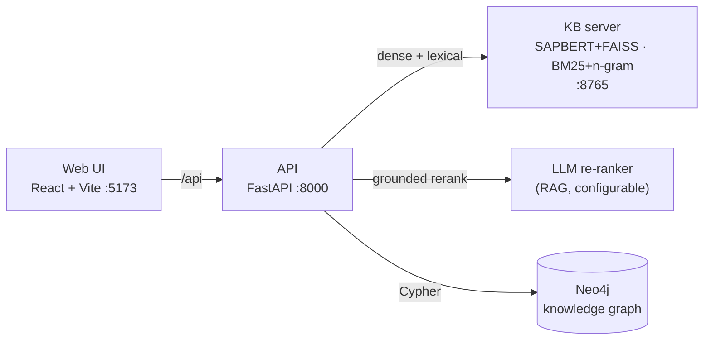

<div align="center">


# HELIX

**H**ybrid **E**ntity **L**inking with **I**nteractive e**X**pert-in-the-loop Annotation

*A configurable, human-in-the-loop tool for linking entity mentions to a knowledge base —
combining hybrid dense + lexical retrieval, grounded LLM re-ranking, and knowledge-graph-aware review.*

<!-- TODO: update badge links once the repo is public -->


</div>

---

## Overview

HELIX helps expert annotators link entity mentions in text to canonical entries in a
knowledge base (e.g. UMLS). Fully automated entity linking still falls short of the
precision curated resources need, so HELIX keeps a human in the loop while making each
decision as fast and as informed as possible:

- **Hybrid retrieval** — dense (SAPBERT + FAISS) *and* lexical (BM25 + character n-grams)
  candidates, fused with reciprocal rank fusion. The lexical strand recovers short
  mentions and abbreviations (`DM` → *Diabetes Mellitus*) that dense encoders miss.
- **Grounded LLM re-ranking** — a language model picks the best candidate with a rationale
  and confidence, *constrained to the retrieved IDs* (it can never invent an out-of-KB
  concept). Optional, per-session, with disk caching and graceful fallback.
- **Graph-aware disambiguation** — a Neo4j knowledge graph shows each candidate's
  neighbourhood, and a **document-level review** assembles all accepted entities into one
  subgraph, flags *isolated* picks, and lets you rearrange IDs until the document is
  coherent.
- **Efficient workflow** — multi-value selection (pipe-joined), configurable auto-select
  with countdown, document context panel, keyboard navigation, resumable sessions, and
  provenance-friendly output.

> HELIX is **domain-agnostic** — it works with any FAISS-indexable KB and any Neo4j graph.
> UMLS / biomedical is the running example.

---

## Architecture



Every back end is **optional and per-session configurable**. Run retrieval only, add the
LLM re-ranker, and/or connect the graph — HELIX degrades gracefully if any piece is absent.

---

## Quick start

### Option A — Docker (all services)

```bash
cp .env.example .env                          # secrets + host paths for the FAISS index
cp neo4j.docker.example.yaml neo4j.docker.yaml
docker compose up --build                     # → http://localhost:5173
```

See **[docker/README.md](docker/README.md)** for the important caveats (KB endpoint URL,
Neo4j URI, CPU-only inference).

### Option B — local launcher

```bash
conda env create -f environment.yml && conda activate helix   # or use a venv
cd web && npm install && cd ..

# configure the KB index (kb/config.yaml) and, optionally, neo4j.yaml + ANTHROPIC_API_KEY
./run.sh                                       # starts KB + API + web together → :5173
```

`run.sh` launches all three services, streams their logs, and stops them together on
`Ctrl+C`. (It auto-detects an activated conda env; run `./run.sh`, not `sh run.sh`.)

### Option C — three terminals

```bash
python kb/server.py --host 0.0.0.0            # 1. KB server  :8765
uvicorn api.main:app --reload --port 8000     # 2. API        :8000
cd web && npm run dev                         # 3. web        :5173
```

---

## Setup details

<details>
<summary><b>1. Python environment</b></summary>

```bash
conda env create -f environment.yml && conda activate helix
# or:
python3.11 -m venv .venv && source .venv/bin/activate
pip install -r requirements.txt
```
On Apple Silicon, if `faiss-cpu` fails via pip, install it from conda-forge
(`conda install -c conda-forge faiss-cpu`) and re-run pip.
</details>

<details>
<summary><b>2. KB server (SAPBERT FAISS + lexical)</b></summary>

Point **`kb/config.yaml`** at your FAISS index and (optional) adapter:

```yaml
server: { host: "127.0.0.1", port: 8765 }
index:   { path: "/path/to/index/prefix" }     # no file extension
adapter: { path: "/path/to/adapter", name: null }
lexical: { enabled: true }                      # BM25 + n-gram; needed for hybrid retrieval
```

CLI/env overrides: `--index_path`/`KB_INDEX_PATH`, `--adapter_path`/`KB_ADAPTER_PATH`,
`--host`/`KB_HOST`, `--port`/`KB_PORT`. See **[kb/SEARCH_SETUP.md](kb/SEARCH_SETUP.md)**.
</details>

<details>
<summary><b>3. LLM re-ranking (optional)</b></summary>

Set `ANTHROPIC_API_KEY` in the environment (or a per-session key in the Configure page),
then enable **LLM re-ranking** for a session. Model and prompt are configurable per session;
responses are cached on disk and fall back to retrieval top-1 on any error.
</details>

<details>
<summary><b>4. Neo4j graph (optional)</b></summary>

```bash
cp neo4j.example.yaml neo4j.yaml               # set uri / user / password / database + schema
```
Build the graph from UMLS (no dataset committed) — see **[graph/README.md](graph/README.md)**:
```bash
cp graph/graph_config.example.yaml graph/graph_config.yaml
python graph/build_graph.py                    # UMLS RRF → CSVs → Neo4j (with English names)
```
Then enable **Graph neighbourhood** for a session.
</details>

---

## Using HELIX

1. **New session** → upload a CSV/TSV, pick the mention column and context columns, add one
   or more KBs, and toggle LLM re-ranking / graph as needed.
2. **Annotate** — for each mention: read it in document context, pick one **or several**
   candidates (multi-match saves pipe-joined, e.g. `C0011849|C0011860`), or mark `NIL`.
   Auto-select pre-picks the best after a countdown; the floating graph panel shows how the
   candidates connect.
3. **Review document** — once a document is annotated, open the review to see all picks as a
   graph, spot **isolated** selections, optionally overlay a mention's other candidates, and
   switch IDs until the document is coherent.
4. **Export** — download `sessions/<name>/annotated.csv` any time. Sessions are resumable.

---

## Evaluation

Score the automatic pipeline against an already-annotated gold set (multi-gold, any-match):

```bash
cp eval/eval_config.example.yaml eval/eval_config.yaml   # gold file + columns + KB endpoint
python eval/score.py --config eval/eval_config.yaml
```

Reports **Acc@1** and **Recall@k** per configuration (lexical / dense / hybrid / hybrid+LLM)
with breakdowns by mention length and entity type. See **[eval/README.md](eval/README.md)**.

---

## Project layout

```
HELIX/
├── web/                     # React + Vite + TypeScript front end
├── api/main.py              # FastAPI backend — retrieval, LLM rerank, graph, sessions
├── eltool/                  # core library
│   ├── config.py            # KBConfig, SessionConfig (Pydantic)
│   ├── kb_client.py         # generic REST client for the KB server
│   ├── llm_reranker.py      # grounded LLM re-ranking (RAG)
│   ├── graph_client.py      # Neo4j neighbourhood + document subgraph queries
│   ├── store.py / session.py# I/O, resume logic, session paths
├── kb/                      # KB server (SAPBERT FAISS + BM25/n-gram lexical)
│   ├── server.py · search_sapbert_index.py · lexical_search.py · config.yaml
├── graph/                   # UMLS → Neo4j builder (with English concept names)
├── eval/                    # evaluation harness (Acc@1 / Recall@k ablation)
├── docker/                  # Dockerfiles + nginx + compose docs
├── paper/                   # LaTeX paper (Springer LNCS)
├── run.sh                   # launch KB + API + web together
├── docker-compose.yml · environment.yml
├── requirements.txt · requirements-api.txt · requirements-kb.txt
├── neo4j.example.yaml · neo4j.docker.example.yaml
└── sessions/                # created at runtime (one folder per session)
```

---

## Configuration files

| File | Purpose | Committed? |
|---|---|---|
| `kb/config.yaml` | KB server: index/adapter paths, lexical on/off | example in repo |
| `neo4j.yaml` | Neo4j connection + graph schema | **git-ignored** (copy from `.example`) |
| `graph/graph_config.yaml` | UMLS→Neo4j build paths | **git-ignored** |
| `eval/eval_config.yaml` | gold file + columns + KB endpoint | **git-ignored** |
| `.env` | Docker secrets + host mounts | **git-ignored** |

Secrets (`neo4j.yaml`, `.env`, per-session API keys, `sessions/`) are excluded via
`.gitignore`.

---

## Output format

`sessions/<name>/annotated.csv` = all input columns + `annotator` + one column per KB.
Each KB value is a KB ID, several pipe-joined IDs (multi-match), a manual ID, or `NIL`.

| entity_text | document_id | annotator | UMLS |
|---|---|---|---|
| Lung | 25823274_en | lakshan | C4037972 |
| DM | d2 | lakshan | C0011849\|C0011860 |
| penicillin | d3 | lakshan | NIL |

---

## Testing without a real index

```bash
python scripts/mock_kb.py        # tiny mock KB on :8765 (no model needed)
uvicorn api.main:app --reload --port 8000
cd web && npm run dev
```

---

## Citation

If you use HELIX, please cite the paper (see [`paper/`](paper/)):

```bibtex
@inproceedings{helix2026,
  title     = {HELIX: Hybrid Entity Linking with Interactive eXpert-in-the-loop Annotation},
  author    = {Karunathilake, Lakshan and Takeda, Hideaki},
  booktitle = {TODO: venue},
  year      = {2026}
}
```

---

## License

TODO: choose a license (e.g. MIT / Apache-2.0) and add a `LICENSE` file.

> **Note on data:** UMLS and other biomedical resources require their own licenses from the
> National Library of Medicine. No licensed datasets are included in this repository.
